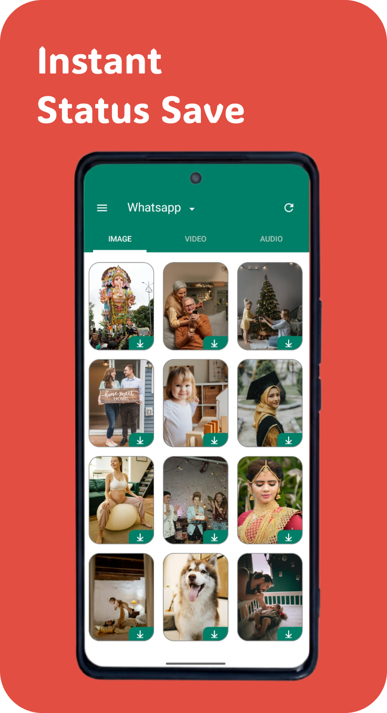
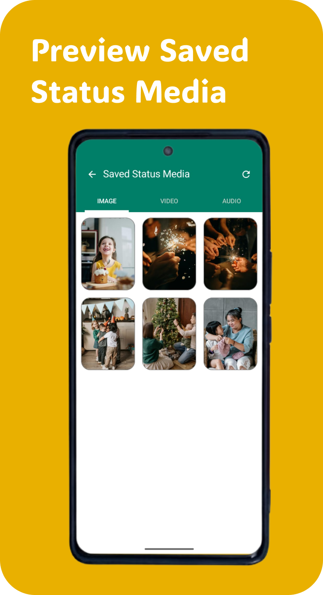

# 📥 WaStatusSaver

[](https://developer.android.com/)
[](https://kotlinlang.org/)
[](https://www.gnu.org/licenses/agpl-3.0)

A high-performance Android utility designed to permanently save **WhatsApp** and **WhatsApp Business** statuses in high quality. This application helps you preserve disappearing media with a fast, privacy-focused experience that keeps your media on your device. 🚀

### Get From
> [](https://github.com/VSurendhar/WaStatusSaver/releases)
> [](https://play.google.com/store/apps/details?id=com.voiddevelopers.wastatussaver&hl=en)

---

## ✨ Key Features

* 🎼 **Multi-Format Support**: Seamlessly save status updates in **Audio, Video, and Image** formats.
* 💎 **High Quality Saves**: Videos and audio are copied as-is in their **Original Quality**; images are saved as JPEG at maximum quality.
* 🔄 **Dual Source Support**: Easily toggle and save media from both **WhatsApp** and **WhatsApp Business**.

---

## 📸 Screenshots

<div align="center">
  
  
  
</div>

---

## 📁 Organized File Architecture

The application maintains a clean and professional directory structure within your local storage:

`📂 Internal Storage / Download / WaStatusSaver /`
* 🖼️ **Image** - High-resolution photos.
* 🎬 **Video** - Full-quality video clips.
* 🎵 **Audio** - Voice notes and audio updates.

---

## 🛠️ Technical Implementation

* 🛡️ **Scoped Storage Compliant**: Designed to work with the latest Android permission models.
* 🗂️ **Storage Access Framework (SAF)**: Reads only the WhatsApp `.Statuses` folder the user grants, with a persisted read permission, so access is asked for once per app.
* 💾 **MediaStore**: Saves statuses to the public Downloads folder without any storage permission.
* ⚙️ **Preferences DataStore**: Stores settings such as the selected app (WhatsApp / WhatsApp Business) and the onboarding state.
* 🎨 **Jetpack Compose & Material 3**: Declarative UI with Navigation Compose, built on ViewModels, Coroutines and StateFlow.
* 💉 **Hilt**: Dependency injection across the app.
* ▶️ **Media3 ExoPlayer**: In-app video and audio playback.
* 🖼️ **Coil**: Image loading and video thumbnails.
* 📊 **Mixpanel**: Usage analytics, behind a common interface so other clients can be added.
* 🔒 **Privacy-First**: Your media stays on-device and is never uploaded by the app; only usage analytics are sent.

---

## 🧱 Project Structure

```text
WaStatusSaver/
├── app/
│   ├── build.gradle.kts
│   └── src/main/
│       ├── AndroidManifest.xml
│       ├── java/com/voiddevelopers/wastatussaver/
│       │   ├── MyApplication.kt          # Application entry point
│       │   ├── core/
│       │   │   └── analytics/            # Analytics events and clients
│       │   ├── data/
│       │   │   ├── prefdatastoremanager/ # Preferences DataStore
│       │   │   └── utils/                # Constants, helpers and extensions
│       │   ├── di/
│       │   │   └── module/               # Hilt modules
│       │   ├── domain/
│       │   │   ├── model/                # Media models
│       │   │   └── usecases/             # Reading and saving statuses
│       │   ├── navigation/               # Routes and NavHost
│       │   └── presentation/
│       │       ├── receivers/            # Broadcast receivers
│       │       ├── theme/                # Compose theme
│       │       └── ui/
│       │           ├── main/             # Home screen and onboarding dialog
│       │           ├── player/           # Image viewer, video and audio player
│       │           ├── savedStatus/      # Saved Status screen
│       │           └── webView/          # Privacy Policy screen
│       └── res/                          # Drawables, strings and themes
├── assets/                               # README images
├── fastlane/                             # Store listing metadata
├── gradle/                               # Version catalog and wrapper
├── build.gradle.kts
└── settings.gradle.kts
```

---

## ⚖️ License
This project is licensed under the **GNU Affero General Public License v3.0 (AGPL-3.0)**. See the [LICENSE](LICENSE) file for details.

---

## 📜 Disclaimer
*This app is not affiliated with, sponsored, or endorsed by WhatsApp Inc. "WhatsApp" is a trademark of WhatsApp Inc.*
