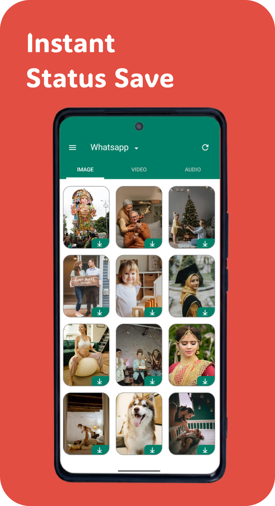
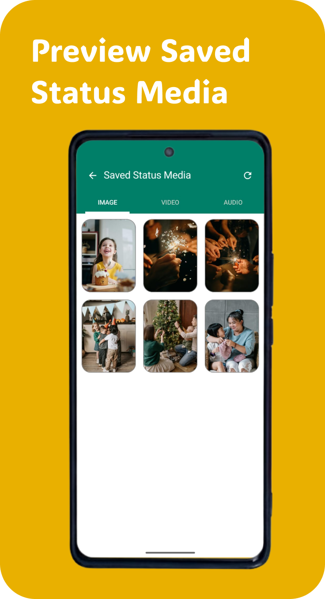
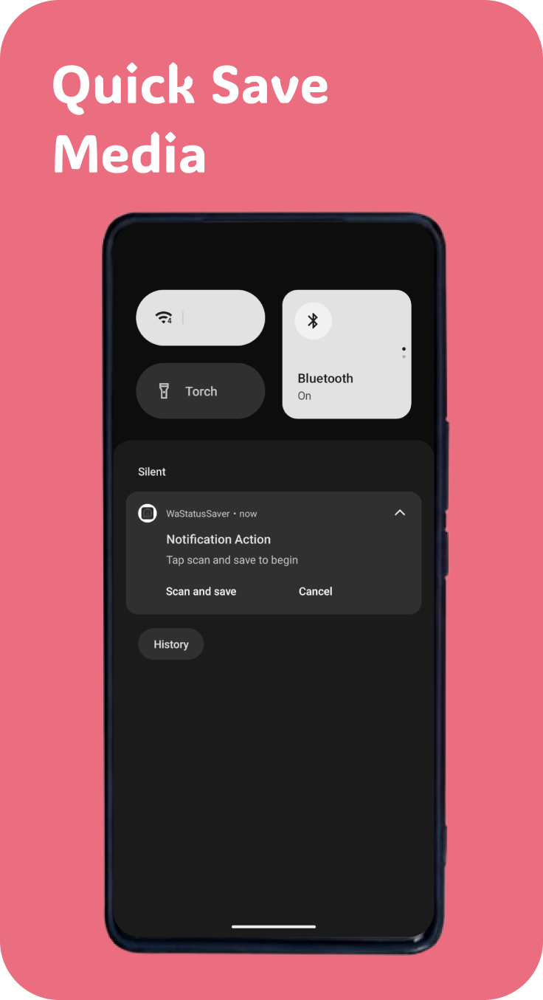
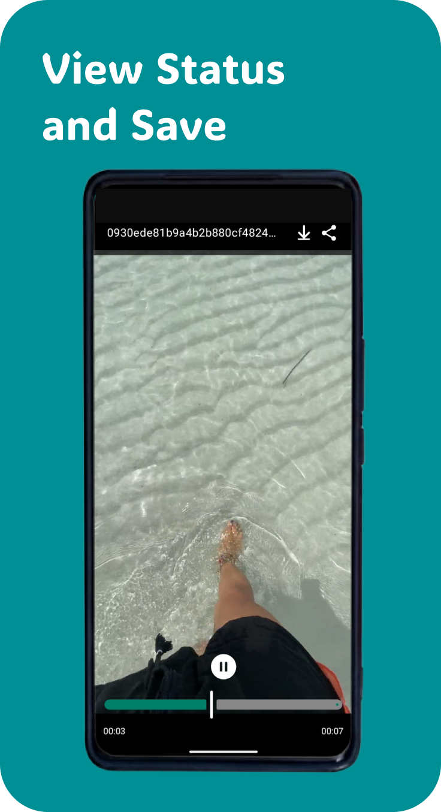

<div align="center">

# 📥 WaStatusSaver

**Save WhatsApp and WhatsApp Business statuses in their original quality, on-device.**

[](https://developer.android.com/)
[](https://kotlinlang.org/)
[](https://developer.android.com/jetpack/compose)
[](https://developer.android.com/about/versions/10)
[](https://www.gnu.org/licenses/agpl-3.0)

[](https://github.com/VSurendhar/WaStatusSaver/releases)

</div>

---

## 📑 Table of Contents

- [Features](#-features)
- [Screenshots](#-screenshots)
- [Where Files Are Saved](#-where-files-are-saved)
- [Tech Stack](#️-tech-stack)
- [Building from Source](#-building-from-source)
- [License](#️-license)
- [Disclaimer](#-disclaimer)

---

## ✨ Features

| | Feature | Description |
|---|---|---|
| 🎼 | **Images, Videos & Audio** | Save every kind of status update. |
| 💎 | **Original Quality** | Files are copied directly from the source — no re-encoding, no compression. |
| 🔄 | **WhatsApp & WhatsApp Business** | Switch between both sources from within the app. |
| 🔔 | **Quick Save from Notification** | Save new statuses with a single tap, without opening the app. |
| 🎯 | **Media-Type Filtering** | Choose which media types (Images, Videos, Audio) appear in Quick Save. |
| 🔒 | **Privacy-First** | Everything happens on-device; no media is uploaded or shared. |

---

## 📸 Screenshots

<div align="center">
  
  
  
  
</div>

---

## 📁 Where Files Are Saved

Saved media is organised by type:

```
Internal Storage/
└── Download/
    └── WaStatusSaver/
        ├── Images/   # Photos
        ├── Videos/   # Video clips
        └── Audio/    # Voice notes & audio updates
```

---

## 🛠️ Tech Stack

- **Language:** Kotlin
- **UI:** Jetpack Compose, Material 3, Navigation Compose
- **Dependency Injection:** Hilt
- **Background Work:** Foreground Service + WorkManager (Quick Save notifications)
- **Media Playback:** AndroidX Media3 (ExoPlayer)
- **Image & Video Thumbnails:** Coil
- **Persistence:** Jetpack DataStore
- **Storage:** Scoped Storage compliant (Android 10+)

**Requirements:** Android 10 (API 29) or higher · Target SDK 36

---

## 🚀 Building from Source

1. **Clone the repository**
   ```bash
   git clone https://github.com/VSurendhar/WaStatusSaver.git
   cd WaStatusSaver
   ```

2. **Open in Android Studio** and let Gradle sync.

3. **Build a debug APK**
   ```bash
   ./gradlew assembleDebug
   ```

4. **Release builds (optional)** require a `secrets.properties` file in the project root and a keystore at `waStatusSaver.jks`:
   ```properties
   SIGNING_KEY_ALIAS=your_alias
   SIGNING_KEY_PASS=your_key_password
   SIGNING_STORE_PASS=your_store_password
   ```
   Then run:
   ```bash
   ./gradlew assembleRelease
   ```

> ⚠️ Never commit `secrets.properties` or your keystore — both are git-ignored.

---

## ⚖️ License

This project is licensed under the **GNU Affero General Public License v3.0 (AGPL-3.0)**. See the [LICENSE](LICENSE) file for details.

---

## 📜 Disclaimer

*This app is not affiliated with, sponsored, or endorsed by WhatsApp Inc. "WhatsApp" is a trademark of WhatsApp Inc.*
